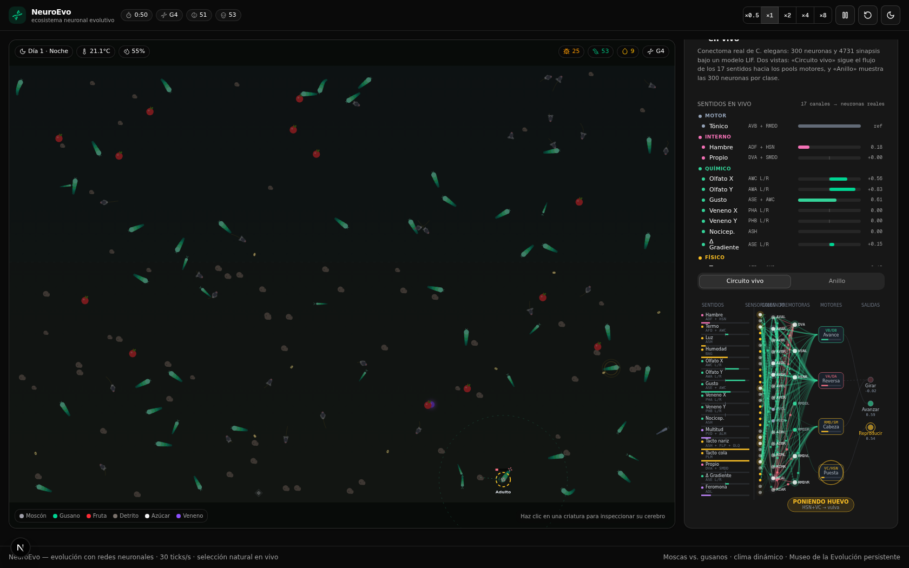
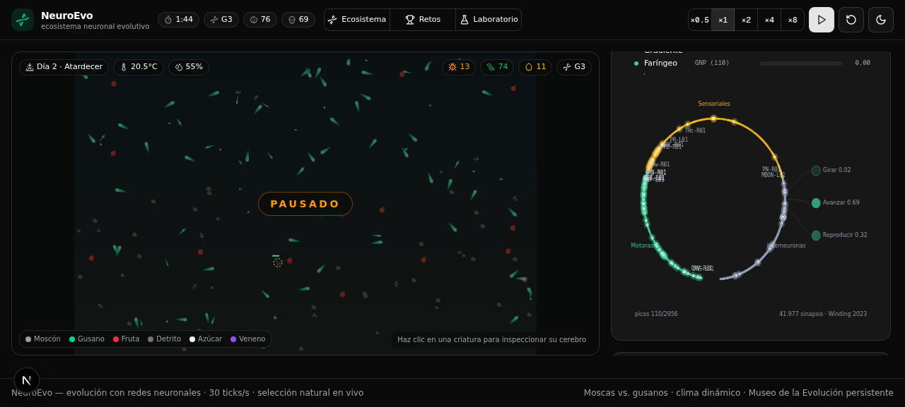
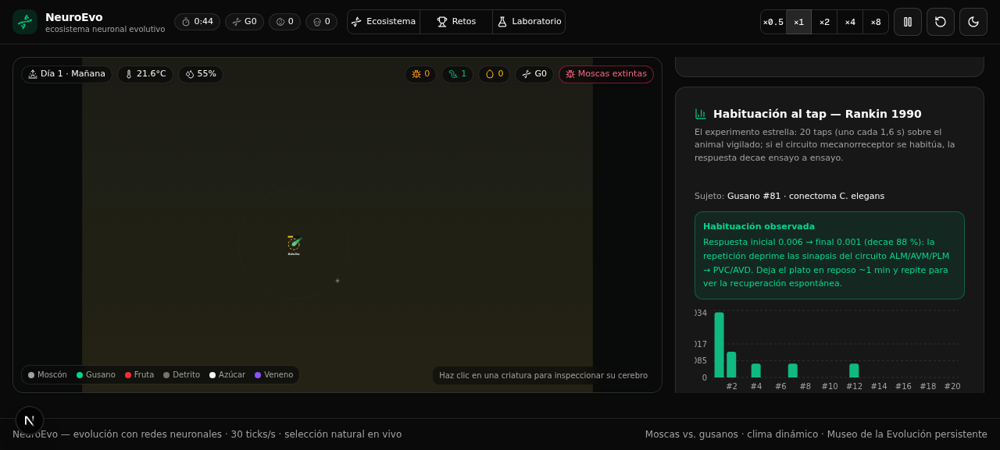
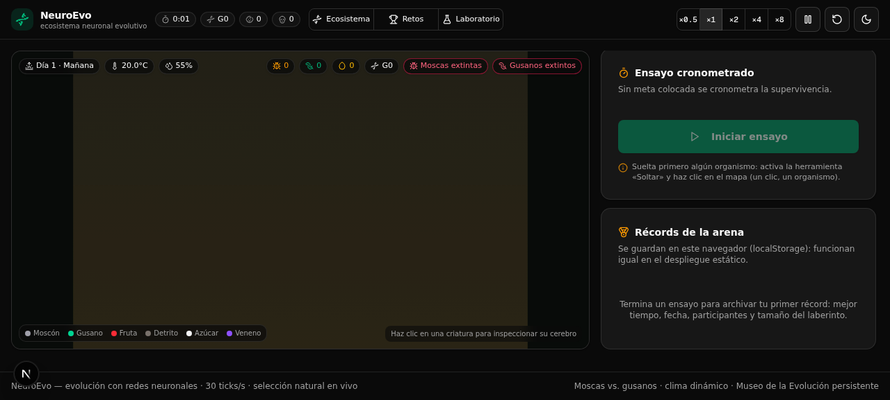

<div align="center">

# 🧬 NeuroEvo

**Ecosistema neuronal evolutivo** — moscas y gusanos controlados por redes
neuronales compiten, se adaptan y evolucionan bajo un clima dinámico,
directamente en tu navegador.


[](https://github.com/juanruiz85/neuroevo/releases)


**▶ [Probar en vivo](https://juanruiz85.github.io/neuroevo/)** — la simulación completa corre en tu navegador, sin instalar nada.

[🧠 Arquitectura](docs/ARQUITECTURA.md) ·
[🪱 Conectoma C. elegans](docs/CONNECTOMA-C-ELEGANS.md) ·
[🔬 Sentidos, ciclo de vida y reproducción](docs/SENSORES-CICLO-REPRODUCCION.md) ·
[🛠️ Cómo se creó](docs/DESARROLLO.md) ·
[📜 Changelog](CHANGELOG.md) ·
[📓 Bitácora de trabajo](docs/worklog.md)

</div>

---

## ¿Qué es?

NeuroEvo es una **simulación de vida artificial** en tiempo real. Cada mosca y
cada gusano posee un pequeño **cerebro** (una red neuronal) que controla por
completo su comportamiento. Nadie les enseña nada: los cerebros iniciales son
aleatorios y los inútiles mueren de hambre. Los que por azar comen y se
reproducen dejan descendencia con **cerebros mutados**, y tras varias
generaciones la selección natural produce criaturas cada vez más eficientes.

Todo ocurre bajo un **clima que tú controlas en vivo**: temperatura, humedad,
lluvia, ciclo día/noche, abundancia de comida y veneno. El objetivo es
observar (y documentar) cómo evoluciona cada especie para adaptarse.

## ✨ Características

- 🪱 **Gusano con conectoma real**: *C. elegans* — 300 neuronas y 4.731
  sinapsis reales de OpenWorm bajo un modelo LIF, con **17 sentidos**
  mapeados a neuronas reales (AFD termo, ASE gusto, ASH luz/nariz, PLM cola,
  DVA propiocepción, ADL feromona…).
- 🪰 **Mosca con conectoma real (Fase 2)**: el cerebro larvario completo de
  *Drosophila melanogaster* (**Winding et al. 2023, Science**): 2.956
  neuronas, 41.977 sinapsis, **18 sentidos** mapeados a los grupos neuronales
  anotados con cada modalidad real (42 ORNs olfativas, 132 GRNs gustativas,
  29 PRs visuales, 85 GUT viscerales, 14 MEC táctiles…) y salidas por los
  pools descendentes reales (DN-VNC avance, asimetría L/R giro, DN-SEZ
  puesta). La ANN 12→8→3 queda como **control experimental** sembrable.
- 🪰🪱 **Dos especies con nichos distintos**: las moscas ven de día y comen
  fruta; los gusanos "huelen" con la humedad y comen detritos. Ambos compiten
  por el azúcar.
- 🌦️ **Clima dinámico**: el frío reduce el voltaje de sus neuronas (se
  adormecen — Q10 en los gusanos), el calor quema energía, la lluvia genera
  comida para los gusanos y la noche ciega a las moscas.
- 🧬 **Evolución medible**: la selección natural ajusta la **neuromodulación**
  del conectoma, nunca su estructura — gusanos: 26 genes (17 sentidos + escalas
  ACh/GABA/Glu + dinámica LIF + fatiga de disparo); moscas: 27 genes. La ANN
  control evoluciona sus 131 pesos. Generaciones, linajes y gráficas en vivo.
- 🧬 **Ciclo de vida real**: huevo → L1 → L2 → L3 → L4 → adulto con
  duraciones del nematodo (1 s ≈ 1 h a 20 °C), desarrollo con Q10
  térmica, larvas que crecen de verdad y senescencia adulta. Con hambruna,
  las larvas forman la fase **dauer** de supervivencia (boca sellada,
  metabolismo 5 %) y reviven al oler comida.
- 🥚 **Reproducción 100 % neural**: los hermafroditas autofecundados maduran
  huevos con energía y esperma limitado, la **feromona de conglomerado**
  frena la puesta con multitud y **solo el circuito real HSN+VC** deposita
  los huevos en el mundo, que incuba y eclosionan como L1. Ningún gusano
  aparece por programación.
- 🔬 **Inspector neuronal**: haz clic en cualquier criatura y observa su
  cerebro en vivo — la nueva vista **"Circuito vivo"** (sentidos → comando →
  pools motores con las sinapsis reales animadas, partículas y estado
  conductual), el anillo del conectoma y los **sentidos dibujados sobre el
  propio gusano** (olfato, fotofobia, tacto, propiocepción, feromona).
- 🥚 **Huevos para todos**: las moscas también ponen huevos por su circuito
  DN-SEZ (vitelo, incubación con Q10 propia de 25 °C) — la ANN control
  conserva el brote directo clásico.
- 🧪 **Laboratorio de neurobiología (Fase 2)**: estímulos controlados (golpe
  al plato con electrodo virtual sobre el circuito mecanorreceptor REAL,
  sombra que crece, flash, pulso de calor, gota de comida, chorro de aire),
  **ablaciones virtuales por clase neuronal** (ASH, comando de reversa,
  ORNs, PRs, DN-VNC…) y **trazas de actividad a 10 Hz**. Incluye el
  **protocolo guiado de habituación al tap — Rankin 1990** replicado sobre
  el conectoma: respuesta → habituación → recuperación espontánea.
- 🏆 **Modo Retos (Fase 2)**: editor de laberintos (paredes con arrastre,
  meta, fruta, veneno), suelta gusanos o moscas con conectoma real o ANN de
  control, cronómetro de ensayo, desenlaces con causa y **récords
  persistentes**.
- 💾 **Cerebros portátiles**: exporta cualquier cerebro (inspector o Museo)
  como `.neuroevo.json` — arquitectura + genoma + rasgos — e impórtalo para
  sembrar 8 individuos en cualquier simulación.
- 🏛️ **Museo de la Evolución** (con base de datos): guarda las élites
  evolucionadas y siémbralas en simulaciones futuras.
- ⚡ **Rendimiento**: motor desacoplado de React a 30 ticks/s (hasta ×8 de
  velocidad) — **~2,5 ms/tick** con el ecosistema completo: ~65 gusanos con
  conectoma de 300 neuronas + ~15 moscas con el cerebro de 2.956 (banco de
  33 pruebas: docs/PRUEBAS-FASE-2.md).

## 🖥️ La interfaz — tres modos

| | |
|---|---|
|  |  |
| **Inspector · Circuito vivo** (gusano): sentidos → comando → pools con las sinapsis reales animadas | **Inspector · Anillo Drosophila** (mosca): las 2.956 neuronas del cerebro larvario en 3 sectores, en vivo (41.977 sinapsis · Winding 2023) |
|  |  |
| **Laboratorio**: estímulos con electrodo sobre circuitos reales, knockouts, trazas y el protocolo de habituación de Rankin 1990 | **Retos**: editor de laberintos, cronómetro y récords — conectoma real contra ANN de control |
|  |  |
| **Inspector · ANN**: la red clásica 12→8→3 (control experimental) | **Datos**: KPIs, poblaciones (con línea de huevos) y generaciones |

## 🧠 Cómo funciona la simulación

Cada criatura siente y decide **30 veces por segundo**. Desde v1.1.0 conviven
arquitecturas cerebrales intercambiables (patrón Strategy); desde v1.2.0 los
gusanos viven su biología completa, y desde **v1.3.0 las dos especies usan
conectomas reales** y hay tres modos de experimentación.

### 🪱 El gusano: conectoma real de *C. elegans* (Fase 1 + vida real)

Las **300 neuronas y 4.731 sinapsis** del hermafrodita (dataset de
[OpenWorm](https://github.com/openworm/CElegansNeuroML), 55 KB embebidos en la
app) se simulan con un modelo **LIF** (integración y disparo con fugas). El
clima y los recursos se inyectan en las **neuronas sensoriales reales** y la
conducta emerge de los pools motores:

| Estímulo → neuronas reales | Conducta ← pools motores |
|---|---|
| Temperatura → **AFD** (el termosensor real) + AWC | Avanzar ← VB/DB + AVB (pool B de avance) |
| Comida → ASE (gusto), AWC/AWA (olfato) | Girar ← asimetría dorso-ventral RMD/SM/SMB |
| Tacto de nariz → **ASH/FLP** → AVA (circuito real) | Reversa ← VA/DA + AVA (pool A: al retroceder re-orienta) |
| Tacto de cola → **PLM** → PVC (reflejo real) | Reproducirse ← VC + HSN (circuito real de puesta) |
| Humedad → BAG · Hambre → ADF/HSN · Feromona → ADL | |
| Propiocepción → **DVA** · Δ gradiente → ASE (klinotaxis) | |

- **17 sentidos** en total (5 compartidos con nada: exclusivos del gusano),
  cada uno con su ganancia sensorial heredable. Detalle completo en
  [docs/SENSORES-CICLO-REPRODUCCION.md](docs/SENSORES-CICLO-REPRODUCCION.md).
- **Ciclo de vida**: huevo (12 s) → L1 → L2 → L3 → L4 (10-12 s cada una,
  ×Q10 con la temperatura) → adulto (~300 s de senescencia). Las larvas son
  de verdad más pequeñas, lentas y miopes. Hambruna en L2/L3 → **dauer**.
- **Reproducción neural**: maduración de huevos por energía y esperma
  limitado, frenada por feromona de conglomerado, y puesta **solo** cuando
  dispara el circuito HSN+VC. Los huevos eclosionan como L1 con vitelo.

- Sinapsis químicas con signo según el neurotransmisor presináptico (GABA
  inhibitorio) y uniones en gap con difusión de potencial + transmisión de
  picos (así comandan AVA/AVB a los pools motores).
- El algoritmo genético **no toca la estructura sináptica** — es biología.
  Evoluciona la **neuromodulación**: 25 genes (ganancias de los 17 sentidos,
  escalas ACh/Glu/GABA/monoaminas, τ de fuga, umbral, refractario, impulso
  tónico).
- Con frío extremo, el coeficiente **Q10** debilita la entrega sináptica: el
  nemátodo se vuelve letárgico y torpe, como el real.

### 🪰 La mosca: conectoma real de *Drosophila* (Fase 2) + ANN de control

Desde v1.3.0 las moscas piensan con el **cerebro larvario completo de
*Drosophila melanogaster*** (Winding et al. 2023): 2.956 neuronas y 41.977
sinapsis reales bajo el mismo modelo LIF del gusano. Sus **18 sentidos**
excitan los grupos neuronales anotados con la modalidad exacta en el dataset
(42 ORNs del antenalar para el olfato con contraste L/R, 132 GRNs externas y
110 faríngeas para el gusto, 29 PRs para la fotofobia y la sombra que crece,
85 GUTs viscerales para el hambre, 14 MECs para el tacto…), y sus tres
motores leen los pools descendentes reales: **DN-VNC** (avance), la
**asimetría L/R de todas las DNs** (giro — la larva contrae un lado) y
**DN-SEZ** (puesta de huevos, modulada por la ráfaga faríngea al comer).
También heredan klinotaxis con sesgo lateral innato (gen 26). La ANN
12 → 8 → 3 clásica queda como **control experimental** para comparar
biología contra red evolutiva en el mismo mundo (siémbrala desde el
Laboratorio, la Arena o el Museo).

#### 🪰 El control: ANN 12 → 8 → 3

| Entradas (sensores) | Salidas (motores) |
|---|---|
| 1. Sesgo | 1. **Girar** (izquierda/derecha) |
| 2. Energía restante | 2. **Avanzar** (empuje 0–100 %) |
| 3. Confort térmico | 3. **Reproducirse** (impulso reproductivo) |
| 4. Luz (día/noche) | |
| 5. Humedad | |
| 6–8. Comida: dirección relativa y cercanía | |
| 9–11. Veneno: dirección relativa y cercanía | |
| 12. Multitud (vecinos de su especie) | |

> 💡 Cuando hace frío extremo (< 10 °C) el **voltaje neural** cae: las señales
> motoras se debilitan y las criaturas se vuelven lentas y torpes. Cuando hace
> calor extremo (> 33 °C) todo se acelera pero la energía se quema… y puede
> ser mortal.
>
> Detalles completos del conectoma (dataset, LIF, mapeos, simplificaciones
> honestas): [docs/CONNECTOMA-C-ELEGANS.md](docs/CONNECTOMA-C-ELEGANS.md).

### Genética y evolución

- **Moscas**: cuando acumulan energía y su impulso reproductivo se activa,
  tienen una cría directa que hereda los **131 pesos** de su ANN mutados.
- **Gusanos**: la reproducción es la cadena real — huevos internos con
  energía y esperma limitado, feromona frenando la puesta, y el circuito
  **HSN+VC** decidiendo cuándo depositarlos. Cada huevo ya contiene el
  cerebro clonado+mutado (25 genes de neuromodulación) y los rasgos
  heredables (velocidad y visión mutables).
- La aptitud de cada individuo (comidas + hijos + longevidad) decide quién
  entra en el Museo de la Evolución.
- Al morir, los cadáveres se reciclan como detritos: la energía nunca
  desaparece del ecosistema.

## 🚀 Instalación y ejecución

**Requisitos**: [Bun](https://bun.sh) ≥ 1.1 (o Node 20+ con npm), un navegador moderno.

```bash
# 1. Clona el repositorio
git clone https://github.com/juanruiz85/neuroevo.git
cd neuroevo

# 2. Instala las dependencias
bun install

# 3. Configura la base de datos (crea .env y la BD SQLite)
cp .env.example .env
bun run db:push

# 4. ¡Lanza la simulación!
bun run dev
```

Abre <http://localhost:3000> y deja que la evolución haga el resto.

> El archivo `.env` solo necesita `DATABASE_URL` apuntando a un SQLite local;
> la base de datos se regenera en segundos con `bun run db:push`.

## 📁 Estructura del proyecto

```
neuroevo/
├── src/
│   ├── app/
│   │   ├── page.tsx              # Página principal: HUD + pestañas
│   │   ├── layout.tsx            # Tema oscuro/claro + Sonner
│   │   └── api/records/          # API REST del Museo de la Evolución
│   ├── components/
│   │   ├── sim/                  # Interfaz (canvas, paneles, hook)
│   │   │   ├── use-simulation.ts #   puente React ↔ motor (loop rAF)
│   │   │   ├── sim-canvas.tsx    #   canvas interactivo del mapa
│   │   │   ├── environment-panel.tsx  #   presets + sliders
│   │   │   ├── inspector-panel.tsx    #   ficha de la criatura
│   │   │   ├── brain-view.tsx    #   cerebro en vivo (ANN o conectoma)
│   │   │   ├── stats-panel.tsx   #   KPIs + gráficas recharts
│   │   │   ├── museum-panel.tsx  #   guardar/sembrar élites
│   │   │   └── sim-header.tsx    #   controles (pausa, velocidad…)
│   │   └── ui/                   # Componentes shadcn/ui
│   └── lib/
│       ├── sim/                  # ⚙️ MOTOR DE SIMULACIÓN (sin React)
│       │   ├── connectome/       #   🧠 Cerebros (patrón Strategy)
│       │   │   ├── adapter.ts    #     IBrainAdapter + registro de fábricas
│       │   │   └── elegans.ts    #     conectoma C. elegans + motor LIF
│       │   ├── data/c_elegans_connectome.json   # 300 neuronas / 4.731 sinapsis
│       │   ├── nn.ts             #   ANN 12→8→3 de las moscas + mutación
│       │   ├── creature.ts       #   ciclo sentir→pensar→actuar
│       │   ├── world.ts          #   mundo, clima, comida, evolución
│       │   ├── render.ts         #   renderer Canvas 2D puro
│       │   ├── rng.ts            #   RNG determinista + gauss
│       │   ├── static-museum.ts  #   Museo en localStorage (modo estático)
│       │   └── types.ts          #   tipos y constantes de balance
│       └── db.ts                 # Cliente Prisma
├── prisma/schema.prisma          # Modelo EvolutionRecord
├── docs/                         # Arquitectura, desarrollo y bitácora
└── db/                           # SQLite local (gitignored)
```

## 🔌 API: Museo de la Evolución

| Método | Ruta | Descripción |
|---|---|---|
| `GET` | `/api/records` | Últimos 60 cerebros guardados (más recientes primero). |
| `POST` | `/api/records` | Guarda una élite: `{ species, generation, fitness, brain: { kind: 'ann' \| 'elegans', weights, traits }, env, name? }` (validado con zod; los registros antiguos sin `kind` se siembran como ANN clásica). |
| `DELETE` | `/api/records/[id]` | Elimina un registro. |

Los cerebros se persisten en SQLite (Prisma) como JSON, listos para sembrarse
en cualquier simulación futura con una ligera mutación.

## 🌐 Despliegue automático (GitHub Pages + Releases)

**Sitio en vivo**: <https://juanruiz85.github.io/neuroevo/>

Cada nueva versión se publica sola mediante el workflow
[`.github/workflows/deploy-pages.yml`](.github/workflows/deploy-pages.yml):

```bash
# 1. Publica una nueva versión (tag anotado)
git tag -a v1.1.0 -m "NeuroEvo v1.1.0"
git push origin v1.1.0

# 2. …y eso es todo: el workflow construye el sitio estático,
#    lo despliega en GitHub Pages y crea la Release v1.1.0
#    con notas autogeneradas y el sitio compilado como .zip adjunto.
```

Cómo funciona:

- **Build estático** (`bun run build:static`) — exporta la app con
  `output: "export"` (Turbopack) excluyendo las rutas de API y calculando
  automáticamente el `basePath` según el repositorio (`/<repo>` para sitios
  de proyecto, vacío para `usuario.github.io`).
- **Museo sin backend** — en el sitio estático no hay servidor, así que el
  Museo de la Evolución degrada con elegancia: los linajes élite se guardan
  en `localStorage` del visitante. La simulación funciona al 100 %: corre
  íntegramente en el navegador.
- **Pages + Release** — `actions/deploy-pages` publica el artefacto y
  `gh release create` genera la Release con `--generate-notes`.
- También puede dispararse manualmente: pestaña **Actions → “Deploy a GitHub
  Pages” → Run workflow**.

## 🎮 Experimentos sugeridos

1. **Selección acelerada**: velocidad ×8 + preset *Banquete* durante 2-3
   minutos → guarda la élite en el Museo.
2. **Prueba de estrés**: aplica *Era de hielo* y siembra tus élites. ¿Sobrevive
   tu linaje al frío que reduce el voltaje de sus neuronas?
3. **Competencia directa**: baja la comida a 0.3× y observa la guerra por el
   azúcar entre especies.
4. **Especiación ecológica**: con *Monzón* los gusanos dominan; con *Ola de
   calor* las moscas colapsan. ¿Cuántas generaciones tardan en adaptarse?
5. **Fósiles vivientes**: guarda élites de generaciones tempranas y compáralas
   con las tardías sembrando ambas en el mismo mundo.
6. **Hambruna y dauer**: baja la comida a 0.1× y espera: los gusanos colapsan
   a larvas **dauer** (las verás quietas y grises con badge violeta). Sube la
   comida de nuevo y observa cómo el olor de los detritos las despierta y la
   población resucita desde sus huevos.
7. **Caza de circuitos**: sigue un gusano en el inspector con la vista
   "Circuito vivo" y espera a que toque una pared con la nariz: verás
   disparar ASH → AVA → VA/DA y el badge cambiar a REVERSA. Tócalo de
   atrás (con la multitud) y verás PLM → PVC acelerando el avance.
8. **Biología vs. azar**: compara el inspector de un gusano (picos/tick y
   actividad media del conectoma LIF) con el de una mosca (ANN). ¿Qué cerebro
   coloniza antes un mundo nuevo: 300 neuronas reales o 131 pesos evolucionados?

7. **Réplica de Rankin (Laboratorio)**: suelta un gusano de laboratorio
   (línea isogénica N2), vigílalo y ejecuta el protocolo de 20 taps: verás
   la respuesta del comando PVC/AVD decaer ensayo a ensayo (habituación) y
   recuperarse tras un minuto de reposo. Activa la ablación ALM+PLM y
   comprueba cómo el reflejo desaparece — la genética de circuitos de
   Wicks & Rankin 1997, sin sacrificar un solo gusano real.
8. **Ceguera experimental (Laboratorio)**: con una mosca de laboratorio
   posada, lanza una sombra que crece: acelerón de escape por los
   fotorreceptores. Ahora silencia los PRs y repite: sin escape. Añade
   vitaminas: silencia DN-VNC y mira qué pasa con el control motor.
9. **Bio vs. azar en laberinto (Retos)**: monta un laberinto con veneno y
   una meta; suelta 3 moscas con conectoma real y 3 con ANN de control.
   Cronometra: ¿cuál de las dos arquitecturas encuentra la salida? Exporta
   el cerebro del campeón y siémbralo en una arena más difícil.
10. **Ingeniería de cerebros**: exporta tu mejor gusano del Museo,
   impórtalo en un mundo con «Era de hielo» y observa si su linaje
   conserva la aptitud. Los archivos `.neuroevo.json` son portátiles:
   compártelos.

## 📚 Documentación adicional

| Documento | Contenido |
|---|---|
| [docs/ARQUITECTURA.md](docs/ARQUITECTURA.md) | Especificación técnica: red neuronal, modelo de energía, clima, grilla espacial, renderer, integración con React, modelo de datos. |
| [docs/CONNECTOMA-C-ELEGANS.md](docs/CONNECTOMA-C-ELEGANS.md) | Fase 1: conectoma real de *C. elegans* — dataset OpenWorm, modelo LIF, mapeos sensoriales/motores, genoma de neuromodulación. |
| [docs/SENSORES-CICLO-REPRODUCCION.md](docs/SENSORES-CICLO-REPRODUCCION.md) | v1.2: los 17 sentidos del gusano, ciclo de vida (huevo→L1→…→adulto, dauer) y reproducción real por circuito HSN+VC. |
| [docs/FASE-2-DROSOPHILA.md](docs/FASE-2-DROSOPHILA.md) | Fase 2 (hoja de ruta): conectoma de *Drosophila* — Janelia MaleCNS, FlyWire/neuPrint, reducción offline con neuprint-python. |
| [docs/DESARROLLO.md](docs/DESARROLLO.md) | Cómo se creó el proyecto: proceso multiagente, decisiones de diseño y verificación E2E. |
| [docs/worklog.md](docs/worklog.md) | Bitácora de trabajo cruda, tarea por tarea. |
| [CHANGELOG.md](CHANGELOG.md) | Historial de versiones. |

## 🛠️ Pila tecnológica

- **Next.js 16** (App Router) + **TypeScript 5**
- **Tailwind CSS 4** + **shadcn/ui** (New York) + **lucide-react**
- **Canvas 2D** para la simulación (renderer puro, sin librerías)
- **recharts** para las gráficas en vivo
- **Prisma ORM** + **SQLite** para el Museo de la Evolución
- **zod** (validación de API), **sonner** (toasts), **next-themes** (tema)

## 📄 Licencia

Distribuido bajo la licencia [MIT](LICENSE).

---

<div align="center">
<sub>Hecho con 🧬, redes neuronales y selección natural.</sub>
</div>
