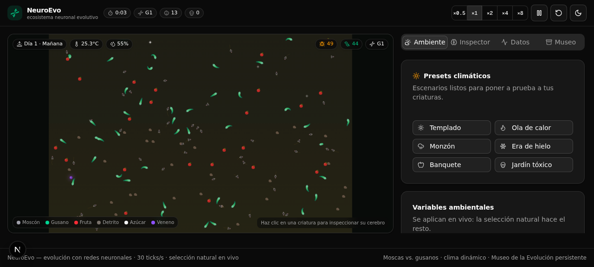
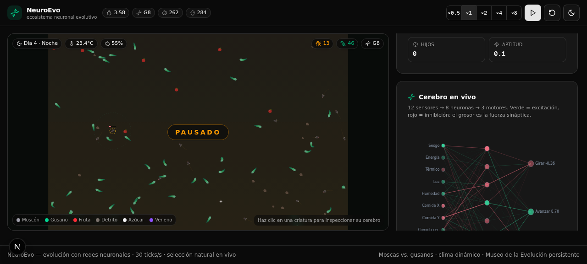
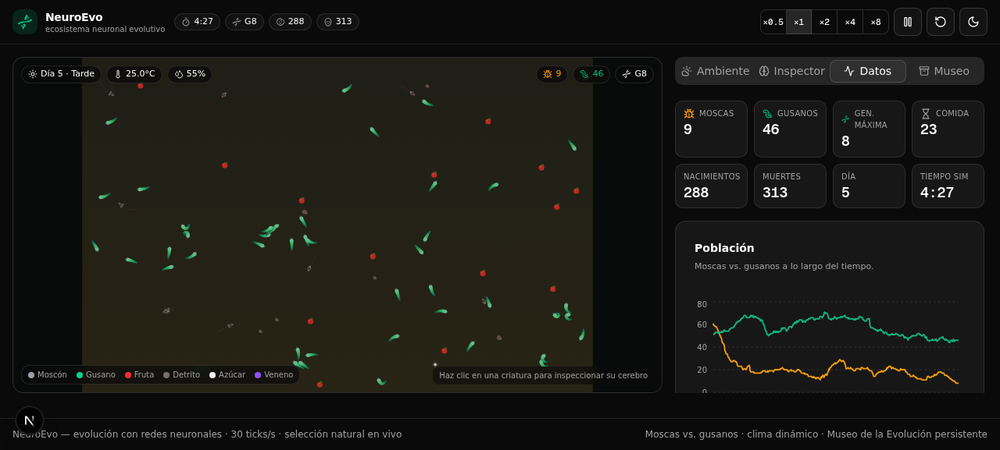
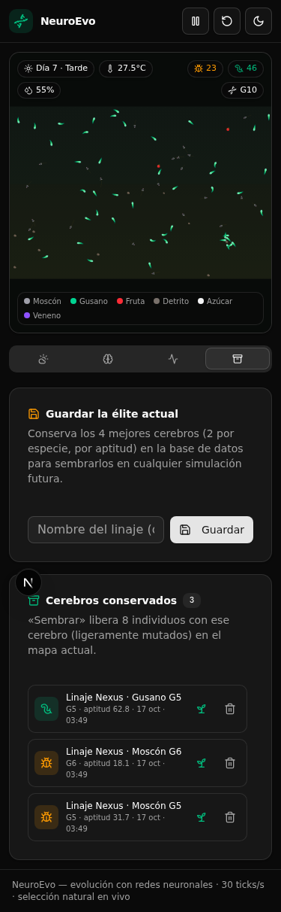

<div align="center">

# 🧬 NeuroEvo

**Ecosistema neuronal evolutivo** — moscas y gusanos controlados por redes
neuronales compiten, se adaptan y evolucionan bajo un clima dinámico,
directamente en tu navegador.




[🧠 Arquitectura](docs/ARQUITECTURA.md) ·
[🛠️ Cómo se creó](docs/DESARROLLO.md) ·
[📜 Changelog](CHANGELOG.md) ·
[📓 Bitácora de trabajo](docs/worklog.md)

</div>

---

## ¿Qué es?

NeuroEvo es una **simulación de vida artificial** en tiempo real. Cada mosca y
cada gusano posee un pequeño **cerebro** (una red neuronal) que controla por
completo su comportamiento. Nadie les enseña nada: los cerebros iniciales son
aleatorios y los inútiles mueren de hambre. Los que por azar comen y se
reproducen dejan descendencia con **cerebros mutados**, y tras varias
generaciones la selección natural produce criaturas cada vez más eficientes.

Todo ocurre bajo un **clima que tú controlas en vivo**: temperatura, humedad,
lluvia, ciclo día/noche, abundancia de comida y veneno. El objetivo es
observar (y documentar) cómo evoluciona cada especie para adaptarse.

## ✨ Características

- 🧠 **Redes neuronales reales**: 12 sensores → 8 neuronas → 3 motores por
  criatura, con 131 pesos sinápticos que se heredan y mutan.
- 🪰🪱 **Dos especies con nichos distintos**: las moscas ven de día y comen
  fruta; los gusanos "huelen" con la humedad y comen detritos. Ambos compiten
  por el azúcar.
- 🌦️ **Clima dinámico**: el frío reduce el voltaje de sus neuronas (se
  adormecen), el calor quema energía, la lluvia genera comida para los
  gusanos y la noche ciega a las moscas.
- 🧬 **Evolución medible**: generaciones, linajes, rasgos heredables
  (velocidad máxima y rango sensorial) y gráficas de población y genética.
- 🔬 **Inspector neuronal**: haz clic en cualquier criatura y observa su
  cerebro iluminándose en tiempo real, sensor por sensor.
- 🏛️ **Museo de la Evolución** (con base de datos): guarda las élites
  evolucionadas y siémbralas en simulaciones futuras.
- ⚡ **Rendimiento**: motor desacoplado de React a 30 ticks/s (hasta ×8 de
  velocidad) con grilla espacial para cientos de criaturas.

## 🖥️ La interfaz

| | |
|---|---|
|  |  |
| **Inspector neuronal**: ficha + cerebro en vivo de la criatura seleccionada | **Datos**: KPIs y evolución de poblaciones, velocidad y generaciones |
|  | **4 pestañas**: Ambiente (presets + sliders), Inspector, Datos y Museo. |
| Diseño responsivo (escritorio y móvil) con tema claro/oscuro | |

## 🧠 Cómo funciona la simulación

### El cerebro (12 → 8 → 3)

Cada criatura siente y decide 30 veces por segundo:

| Entradas (sensores) | Salidas (motores) |
|---|---|
| 1. Sesgo | 1. **Girar** (izquierda/derecha) |
| 2. Energía restante | 2. **Avanzar** (empuje 0–100 %) |
| 3. Confort térmico | 3. **Reproducirse** (impulso reproductivo) |
| 4. Luz (día/noche) | |
| 5. Humedad | |
| 6–8. Comida: dirección relativa y cercanía | |
| 9–11. Veneno: dirección relativa y cercanía | |
| 12. Multitud (vecinos de su especie) | |

> 💡 Cuando hace frío extremo (< 10 °C) el **voltaje neural** cae: las señales
> motoras se debilitan y las criaturas se vuelven lentas y torpes. Cuando hace
> calor extremo (> 33 °C) todo se acelera pero la energía se quema… y puede
> ser mortal.

### Genética y evolución

- Si una criatura acumula energía y su impulso reproductivo se activa, tiene
  una cría que **hereda los 131 pesos** de su cerebro con un 10 % de genes
  mutados (ruido gaussiano).
- También heredan (y mutan) dos **rasgos físicos**: velocidad máxima y rango
  sensorial — verás linajes de corredores veloces y otros de grandes ojos.
- La aptitud de cada individuo (comidas + hijos + longevidad) decide quién
  entra en el Museo de la Evolución.
- Al morir, los cadáveres se reciclan como detritos: la energía nunca
  desaparece del ecosistema.

## 🚀 Instalación y ejecución

**Requisitos**: [Bun](https://bun.sh) ≥ 1.1 (o Node 20+ con npm), un navegador moderno.

```bash
# 1. Clona el repositorio
git clone https://github.com/USUARIO/neuroevo.git
cd neuroevo

# 2. Instala las dependencias
bun install

# 3. Configura la base de datos (crea .env y la BD SQLite)
cp .env.example .env
bun run db:push

# 4. ¡Lanza la simulación!
bun run dev
```

Abre <http://localhost:3000> y deja que la evolución haga el resto.

> El archivo `.env` solo necesita `DATABASE_URL` apuntando a un SQLite local;
> la base de datos se regenera en segundos con `bun run db:push`.

## 📁 Estructura del proyecto

```
neuroevo/
├── src/
│   ├── app/
│   │   ├── page.tsx              # Página principal: HUD + pestañas
│   │   ├── layout.tsx            # Tema oscuro/claro + Sonner
│   │   └── api/records/          # API REST del Museo de la Evolución
│   ├── components/
│   │   ├── sim/                  # Interfaz (canvas, paneles, hook)
│   │   │   ├── use-simulation.ts #   puente React ↔ motor (loop rAF)
│   │   │   ├── sim-canvas.tsx    #   canvas interactivo del mapa
│   │   │   ├── environment-panel.tsx  #   presets + sliders
│   │   │   ├── inspector-panel.tsx    #   ficha de la criatura
│   │   │   ├── brain-view.tsx    #   red neuronal en vivo
│   │   │   ├── stats-panel.tsx   #   KPIs + gráficas recharts
│   │   │   ├── museum-panel.tsx  #   guardar/sembrar élites
│   │   │   └── sim-header.tsx    #   controles (pausa, velocidad…)
│   │   └── ui/                   # Componentes shadcn/ui
│   └── lib/
│       ├── sim/                  # ⚙️ MOTOR DE SIMULACIÓN (sin React)
│       │   ├── nn.ts             #   red neuronal 12→8→3 + mutación
│       │   ├── creature.ts       #   ciclo sentir→pensar→actuar
│       │   ├── world.ts          #   mundo, clima, comida, evolución
│       │   ├── render.ts         #   renderer Canvas 2D puro
│       │   ├── rng.ts            #   RNG determinista + gauss
│       │   └── types.ts          #   tipos y constantes de balance
│       └── db.ts                 # Cliente Prisma
├── prisma/schema.prisma          # Modelo EvolutionRecord
├── docs/                         # Arquitectura, desarrollo y bitácora
└── db/                           # SQLite local (gitignored)
```

## 🔌 API: Museo de la Evolución

| Método | Ruta | Descripción |
|---|---|---|
| `GET` | `/api/records` | Últimos 60 cerebros guardados (más recientes primero). |
| `POST` | `/api/records` | Guarda una élite: `{ species, generation, fitness, brain: { weights, traits }, env, name? }` (validado con zod). |
| `DELETE` | `/api/records/[id]` | Elimina un registro. |

Los cerebros se persisten en SQLite (Prisma) como JSON, listos para sembrarse
en cualquier simulación futura con una ligera mutación.

## 🎮 Experimentos sugeridos

1. **Selección acelerada**: velocidad ×8 + preset *Banquete* durante 2-3
   minutos → guarda la élite en el Museo.
2. **Prueba de estrés**: aplica *Era de hielo* y siembra tus élites. ¿Sobrevive
   tu linaje al frío que reduce el voltaje de sus neuronas?
3. **Competencia directa**: baja la comida a 0.3× y observa la guerra por el
   azúcar entre especies.
4. **Especiación ecológica**: con *Monzón* los gusanos dominan; con *Ola de
   calor* las moscas colapsan. ¿Cuántas generaciones tardan en adaptarse?
5. **Fósiles vivientes**: guarda élites de generaciones tempranas y compáralas
   con las tardías sembrando ambas en el mismo mundo.

## 📚 Documentación adicional

| Documento | Contenido |
|---|---|
| [docs/ARQUITECTURA.md](docs/ARQUITECTURA.md) | Especificación técnica: red neuronal, modelo de energía, clima, grilla espacial, renderer, integración con React, modelo de datos. |
| [docs/DESARROLLO.md](docs/DESARROLLO.md) | Cómo se creó el proyecto: proceso multiagente, decisiones de diseño y verificación E2E. |
| [docs/worklog.md](docs/worklog.md) | Bitácora de trabajo cruda, tarea por tarea. |
| [CHANGELOG.md](CHANGELOG.md) | Historial de versiones. |

## 🛠️ Pila tecnológica

- **Next.js 16** (App Router) + **TypeScript 5**
- **Tailwind CSS 4** + **shadcn/ui** (New York) + **lucide-react**
- **Canvas 2D** para la simulación (renderer puro, sin librerías)
- **recharts** para las gráficas en vivo
- **Prisma ORM** + **SQLite** para el Museo de la Evolución
- **zod** (validación de API), **sonner** (toasts), **next-themes** (tema)

## 📄 Licencia

Distribuido bajo la licencia [MIT](LICENSE).

---

<div align="center">
<sub>Hecho con 🧬, redes neuronales y selección natural.</sub>
</div>
